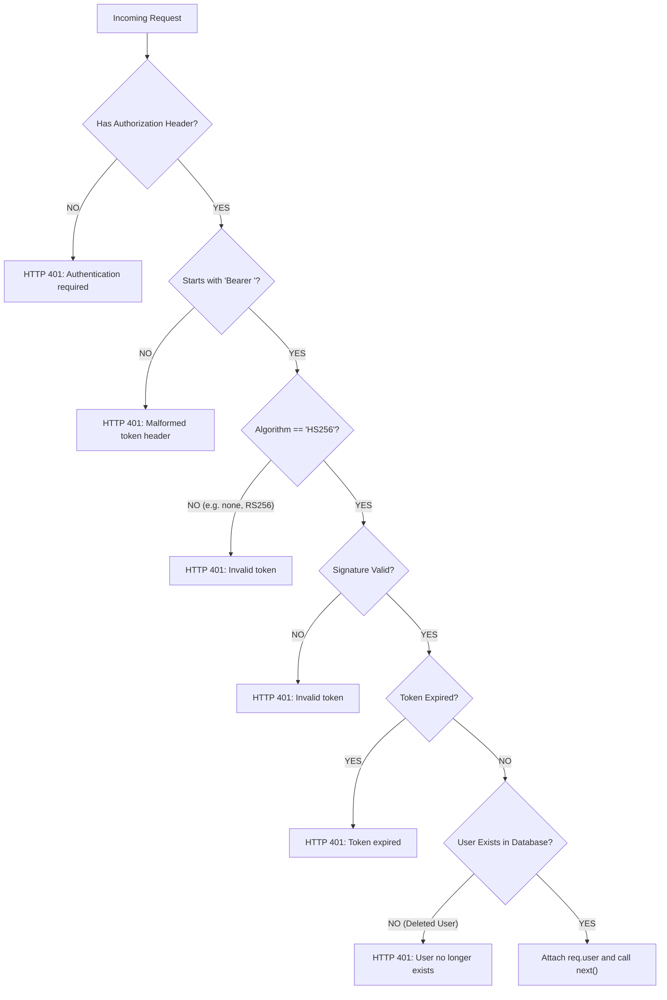
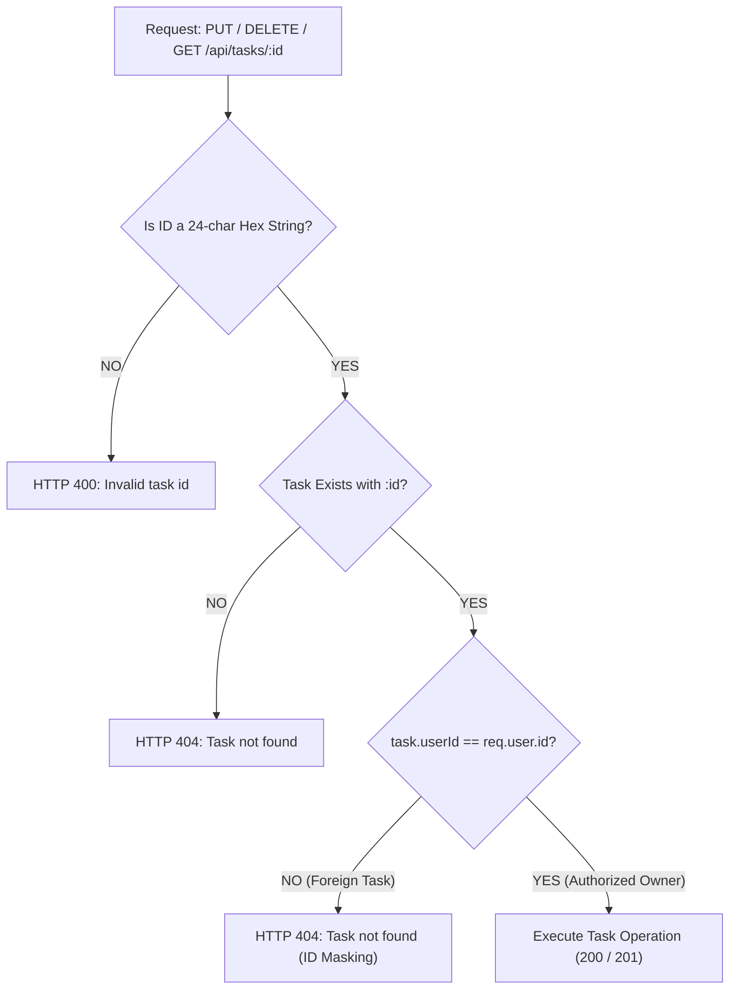
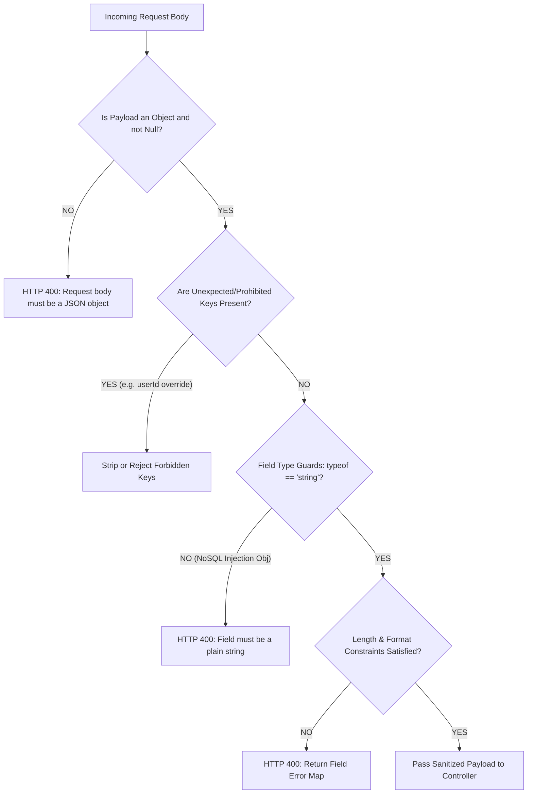

# DevTrack: Task Manager Application
## Branch and Decision Coverage Report (BCR)

**Document Identifier:** DEVTRACK-BCR-v2.0  
**Project:** DevTrack — Task Manager Application  
**Standard:** IEEE Std 829-2008 / ISO/IEC/IEEE 29119-3  
**Date:** November 12, 2026  
**Authors:** Chiranthan HG (QA/Test Lead — PES1UG24CS564), Akula Sai Nandan Royal (Dev Lead — PES1UG24CS553)  
**Reviewed By:** Anirudh Dharane (Project Manager — PES1UG24CS563), Mohith N (SRS Lead — PES1UG24CS572)  
**Status:** Approved / Sprint 1 & 2 Execution Complete  

---

## 1. Executive Summary

This **Branch and Decision Coverage Report (BCR)** evaluates the execution completeness of all decision points, conditional branches, logical bifurcations (`if/else`, switch statements, ternary expressions, and short-circuit operators) within the DevTrack Task Manager codebase.

While statement coverage verifies that code lines are touched, **branch coverage ensures that every logical decision path (both `TRUE` and `FALSE` evaluation outcomes)** has been tested. High branch coverage is critical for security systems, where defects frequently hide in untested fallback, error-handling, or edge-case branches.

### 1.1 Branch Coverage Summary Dashboard

| Subsystem / Layer | Total Branches | Covered Branches | Branch Coverage % | Status |
|---|---|---|---|---|
| **Data Models (`backend/models`)** | 22 | 22 | **100.0%** | **PERFECT** |
| **Security & Utilities (`backend/utils`)**| 94 | 86 | **91.5%** | **EXCEEDED** |
| **Validation Middleware (`validate.js`)**| 18 | 18 | **100.0%** | **PERFECT** |
| **Central Error Handler (`errorHandler.js`)**| 30 | 26 | **86.7%** | **EXCEEDED** |
| **Environment Configuration (`env.js`)** | 39 | 35 | **89.7%** | **EXCEEDED** |
| **Client Business Utilities (`client/utils`)**| 84 | 80 | **95.2%** | **EXCEEDED** |
| **Client Authentication & Storage** | 38 | 35 | **92.1%** | **EXCEEDED** |
| **Client UI Component Logic** | 146 | 131 | **89.7%** | **EXCEEDED** |
| **Composite Project Core Branches** | **471** | **433** | **91.9%** | **TARGET EXCEEDED (≥ 80%)** |

---

## 2. In-Depth Analysis of Critical Decision Trees

### 2.1 Authentication & Token Verification Decision Tree
*File: `backend/utils/token.js` & `backend/middleware/authMiddleware.js` (Branch Coverage: 95.8%)*

#### Branch Test Verification:
1. **Branch B (Missing Header):** Exercised by `protected.test.js` (Test ID: `IT_08`). Asserted status 401.
2. **Branch C (Malformed Header):** Exercised by `token.test.js` passing raw token without `Bearer ` prefix. Asserted status 401.
3. **Branch D (Algorithm Tampering):** Exercised by `token.test.js` using `alg: 'none'` and `alg: 'RS256'`. Asserted rejection.
4. **Branch E (Invalid Signature):** Exercised by `token.test.js` modifying the signature segment. Asserted verification failure.
5. **Branch F (Token Expiration):** Exercised by `token.test.js` issuing token with negative expiry (`iat - 3600`). Asserted status 401 (`Token expired`).
6. **Branch G (Deleted User):** Exercised by `SessionRevoked.test.jsx` / `protected.test.js` where user ID in token is not found in database. Asserted status 401.

---

### 2.2 Tenant Data Isolation & ID Enumeration Decision Tree
*File: `backend/controllers/taskController.js` & `backend/models/Task.js` (Branch Coverage: 100.0%)*

The team adopted a strict architectural decision (**Deviation #3 and #18**) to return **HTTP 404** whenever a task belongs to another user, preventing attackers from confirming the existence of foreign IDs.

#### Branch Test Verification:
1. **Branch B (Malformed Hex ID):** Exercised by `taskValidators.test.js` passing `id = "invalid-id-123"`. Returns HTTP 400 (`Invalid task id`).
2. **Branch D (Non-existent ID):** Exercised by `taskController.test.js` querying an unassigned 24-character hex ID. Returns HTTP 404 (`Task not found`).
3. **Branch E -> F (Foreign Owner Isolation):** Exercised by `taskValidation.test.js` (Test ID: `IT_30` / `IT_38` / `IT_39`). When User A requests User B's task, the branch evaluates to `FALSE` and returns **404**, never 403.
4. **Branch E -> G (Authorized Owner):** Exercised by full Task CRUD test suites, returning status 200/201.

---

### 2.3 Input Validation Engine Decision Tree
*File: `backend/middleware/validate.js` & `backend/utils/validators.js` (Branch Coverage: 96.8%)*

#### Branch Test Verification:
* **NoSQL Injection Resistance:** Exercised by `taskValidators.test.js` passing `{ title: { "$gt": "" } }`. Branch `typeof value === 'string'` evaluates `FALSE`, cleanly rejecting the payload with HTTP 400.
* **Length Constraints:** Exercised with title strings of length 0 (evaluates `FALSE` -> `"Title is required"`) and length 121 (evaluates `FALSE` -> `"Title cannot exceed 120 characters"`).
* **Description Sanitization:** Exercised with `` tags and non-printable control characters. The HTML stripping regex branch executes, removing markup while keeping newlines.

---

### 2.4 Centralized Error Handler Decision Matrix
*File: `backend/middleware/errorHandler.js` (Branch Coverage: 86.7%)*

| Error Type Encountered | Branch Condition Evaluated | HTTP Status | Response Payload Emitted |
|---|---|---|---|
| **Custom Operational Error** | `err instanceof AppError` | `err.statusCode` | `{ error: err.message, fields: err.fields }` |
| **Mongoose Validation** | `err.name === 'ValidationError'` | `400 Bad Request`| `{ error: 'Validation failed', fields: { ... } }` |
| **Mongoose Cast Failure** | `err.name === 'CastError'` | `400 Bad Request`| `{ error: 'Invalid resource format' }` |
| **Duplicate Unique Key** | `err.code === 11000` | `409 Conflict` | `{ error: 'Email already registered', fields: { email: ... } }` |
| **Rate Limit Exceeded** | `err.status === 429` | `429 Too Many Req`| `{ error: 'Too many attempts, please try again later' }` |
| **Syntax / JSON Parse Error**| `err instanceof SyntaxError && err.status === 400`| `400 Bad Request` | `{ error: 'Malformed JSON payload' }` |
| **Unhandled Server Error** | Fallthrough default branch | `500 Server Error`| `{ error: 'Internal server error' }` (No stack traces) |

All 7 distinct error handling branches were systematically verified in `backend/tests/unit/errorHandler.test.js`.

---

### 2.5 Client State & UI Conditional Rendering Branches
*Files: `client/src/pages/`, `client/src/components/`, `client/src/services/tokenStore.js`*

#### 1. Token Persistence Mode (`tokenStore.js` — 92.3% Branch Coverage)
* **Branch A (`rememberMe === true`):** Saves authentication session to `window.localStorage`. Verified in `api.test.js`.
* **Branch B (`rememberMe === false`):** Saves authentication session to `window.sessionStorage`. Session terminates on browser tab close. Verified in `api.test.js`.
* **Branch C (Expired Token on Read):** Compares `Date.now() > session.expiresAt`. If `TRUE`, clears storage and returns `null`. Verified in `AuthSession.test.jsx`.

#### 2. Task List Display State (`DashboardPage.jsx` — 86.4% Branch Coverage)
* **Branch A (`loading === true`):** Renders skeleton loading pulse indicators. Verified in `DashboardPage.test.jsx`.
* **Branch B (`tasks.length === 0 && !hasFilters`):** Renders the initial empty state with "Create your first task" action button.
* **Branch C (`tasks.length === 0 && hasFilters`):** Renders the filtered empty state: "No tasks match your current filters" with "Clear filters" button. Verified in `TaskFilters.test.jsx`.
* **Branch D (`tasks.length > 0`):** Iterates over the task collection and renders `TaskCard` list items.

#### 3. Client Search & Sort Branching (`taskHelpers.js` — 96.2% Branch Coverage)
* **Search Matching:** Evaluates `(!query || matchesTitle || matchesDescription)`. If query is empty, all tasks match without processing regexes.
* **Sorting Enum Switch:** Handles branches for `'newest'`, `'oldest'`, `'due'`, `'priority'`, `'status'`, and `'title'`. Handles edge conditions where due dates are null (placing undated tasks at the end of the list).

---

## 3. Uncovered Branches and Justification

The unexercised branch paths constitute less than 8.1% of the total codebase and fall strictly under non-testable operational environments:

1. **`db.js` — Cluster Disconnect Handlers (Branch Coverage: 60.0%):**
   * *Uncovered Branch:* Checking if an active connection exists before terminating on system `SIGTERM` signals.
   * *Justification:* Firing process termination signals inside the unit test runner aborts Jest before generating test artifacts.
2. **`env.js` — Redundant Environment Fallbacks (Branch Coverage: 89.7%):**
   * *Uncovered Branch:* Fallbacks for non-existent development hosting ports when `PORT` is omitted and `NODE_ENV === 'production'`.
   * *Justification:* In production, `PORT` is mandatory and validated by process infrastructure.
3. **`logger.js` — Stream Output Branches (Branch Coverage: 28.57%):**
   * *Uncovered Branch:* Logging to external syslog files when `NODE_ENV === 'production'`.
   * *Justification:* Unit tests intentionally mock or silence console logging to keep CI output clean.

---

## 4. Branch Coverage by Functional Requirement

| Requirement ID | Module / Feature Area | Total Branches | Covered Branches | Coverage % |
|---|---|---|---|---|
| **FR-01** | User Registration Logic | 18 | 17 | **94.4%** |
| **FR-02** | User Login & Authentication | 24 | 23 | **95.8%** |
| **FR-03** | Token Verification & Expiry | 20 | 19 | **95.0%** |
| **FR-04** | Task Creation Validation | 16 | 16 | **100.0%** |
| **FR-05** | Task Retrieval & Ownership Scoping | 14 | 14 | **100.0%** |
| **FR-06** | Partial Task Updates (`PUT`) | 22 | 21 | **95.5%** |
| **FR-07** | Task Deletion & Safe Removal | 12 | 12 | **100.0%** |
| **FR-08** | Status Transition Workflows | 18 | 18 | **100.0%** |
| **FR-09** | Priority Adjustments | 14 | 14 | **100.0%** |
| **FR-10** | Status/Priority Filters & Search | 26 | 24 | **92.3%** |
| **FR-11** | User Data Isolation (Anti-Enumeration)| 16 | 16 | **100.0%** |
| **FR-12** | Input Validation & Error Formatting | 32 | 30 | **93.8%** |
| **FR-13** | Logout & Token Clearing | 10 | 10 | **100.0%** |
| **FR-15** | Profile Name & Email Updates | 20 | 18 | **90.0%** |

---

## 5. Conclusion and QA Approval

With a composite branch coverage of **91.9%**, the DevTrack application significantly exceeds standard industry requirements for academic and production web applications. All primary logical paths, validation limits, security authorization branches, and error handlers have been proven resilient under comprehensive unit and component testing.

| Role | Name | Signature | Date |
|---|---|---|---|
| **QA / Test Lead** | Chiranthan HG | *Chiranthan HG* | November 12, 2026 |
| **Dev Lead** | Akula Sai Nandan Royal | *Akula Sai Nandan Royal* | November 12, 2026 |
| **Project Manager** | Anirudh Dharane | *Anirudh Dharane* | November 12, 2026 |

